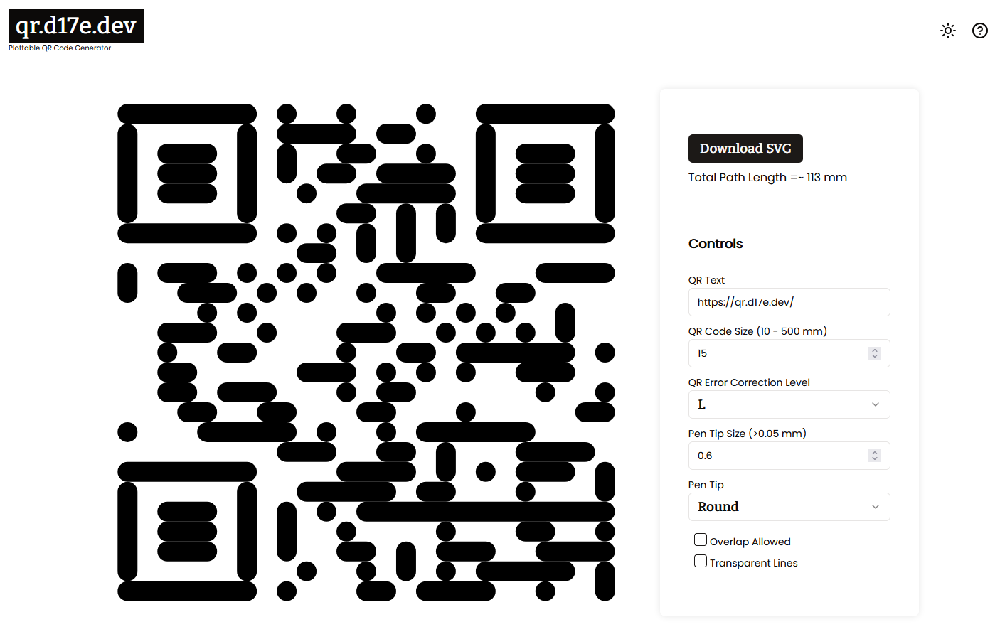

# QR Code Generator for Pen Plotters



This project attempts to solve 1 problem and 1 problem only: generating QR codes that can be efficiently plotted by pen plotters. Or
anything that takes an SVG for that matter.

Visit this project at [qr.d17e.dev](https://qr.d17e.dev) 🟢

## Main Dependencies

- Svelte+SvelteKit as the backbone
- Shadcn-ui for UI components
- qrcode-svg npm package for generating the QR codes
- And a big shout-out to [Stanko, from whom I _borrowed_ the mobile UX](https://github.com/Stanko/pulsar)

## Getting Started

### Prerequisites

- Node.js
- npm

### Installation

1. Clone the repository:
   ```bash
   git clone <repository-url>
   cd <repository-directory>
   ```

2. Install dependencies:
   ```bash
   npm install
   ```

### Development

To start the development server:

```bash
npm run dev
```

To start the server and open the app in a new browser tab:

```bash
npm run dev -- --open
```

### Building

To create a production build:

```bash
npm run build
```

To preview the production build:

```bash
npm run preview
```

## Deployment

To deploy your app, you may need to install an [adapter](https://kit.svelte.dev/docs/adapters) for your target environment.

## QR Code API (Cloudflare Worker)

`worker/` is a small Cloudflare Worker that returns a plottable QR code as SVG over HTTP. It replaces the
old Val Town webhook and gives the same output for the same request.

```bash
curl https://qr-code-webhook.<your-subdomain>.workers.dev -H "Content-Type: application/json" -d '{"value":"https://qr.d17e.dev","ecl":"L","penMmSize":0.5}'
```

- `value`: the content to encode
- `ecl`: error correction level, one of `L`, `M`, `Q`, `H`
- `penMmSize`: pen width in mm; each QR module is one pen width wide

Send all three. A request without a JSON body gets a QR code for `https://qr.d17e.dev` with a 20 mm pen.
`GET` and `POST` both work, and any origin may call it (CORS `*`).

To run it locally on http://localhost:8787 and run its tests:

```bash
cd worker
npm install
npm run dev
npm test
```

[`.github/workflows/worker.yml`](.github/workflows/worker.yml) tests every pull request that touches
`worker/` and deploys to Cloudflare on every push to `main` that does. It needs two repository secrets:
`CLOUDFLARE_API_TOKEN` (a token made from the "Edit Cloudflare Workers" template) and
`CLOUDFLARE_ACCOUNT_ID`.

## License

This project is licensed under the MIT License.

```
